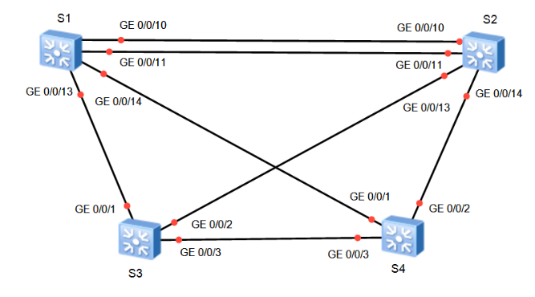
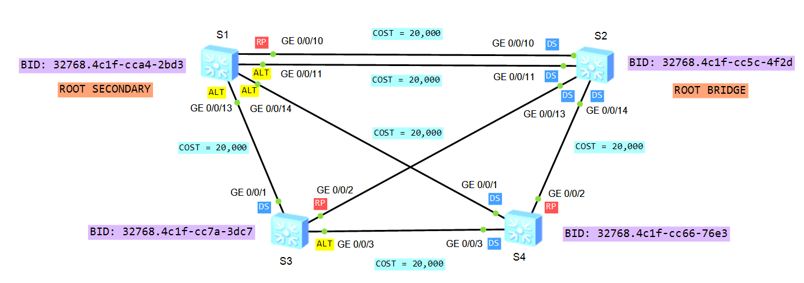
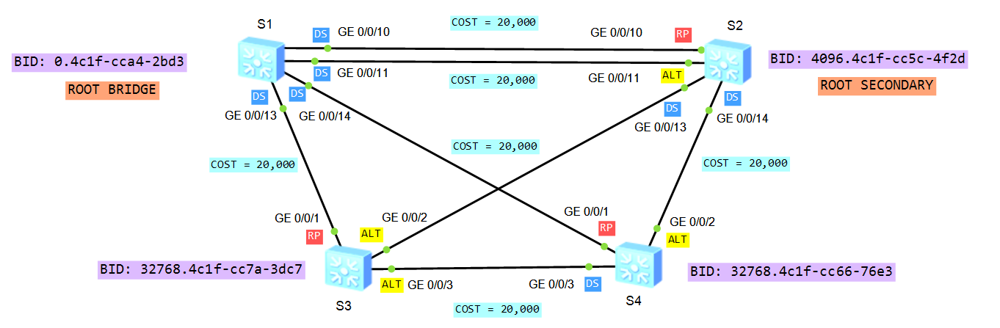
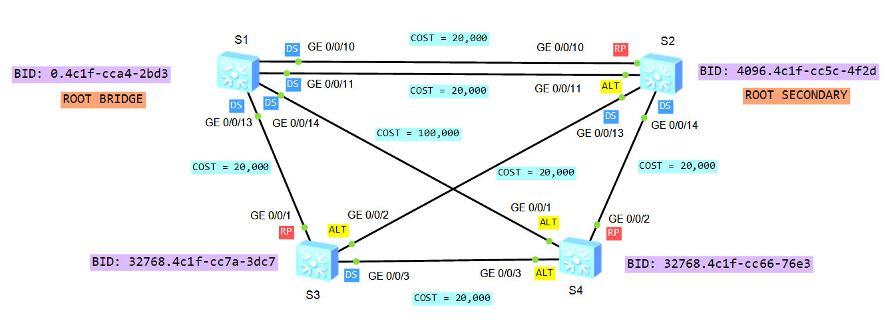
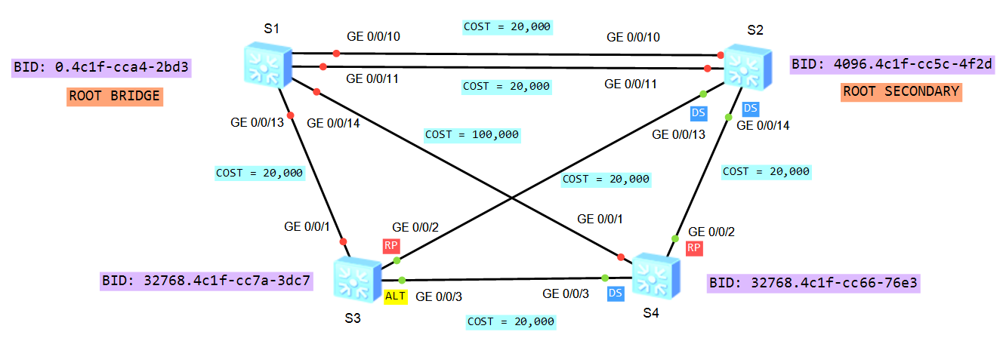
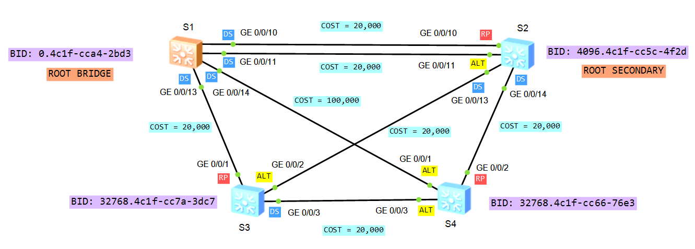

# Laboratorio 01: Spanning Tree Protocol (STP / RSTP)

[](https://e.huawei.com)
[]()
[]()
[]()

Práctica de laboratorio enfocada en la prevención de bucles de Capa 2, convergencia y alta disponibilidad mediante los protocolos **STP (IEEE 802.1D)** y **RSTP (IEEE 802.1w)** sobre switches  **Huawei S5700** en eNSP.


## Topología de Red

La topología está conformada por una malla redundante de 4 switches interconectados con enlaces físicos múltiples:




## Configuración Paso a Paso

### I. Configuración Inicial de Hostnames y Notificaciones

En cada uno de los 4 switches, establecemos el nombre del equipo y desactivamos las alertas informativas de consola para trabajar cómodamente:

```text
<Huawei> system-view

[Huawei] sysname S1

[S1] undo info-center enable
```
*(Repetir en S2, S3 y S4 cambiando el nombre correspondiente).*

---

### II. Habilitación de STP

Activamos STP y forzamos el modo estándar IEEE 802.1D en todos los switches:

```text
[S1] stp enable
[S1] stp mode stp

[S2] stp enable
[S2] stp mode stp

[S3] stp enable
[S3] stp mode stp

[S4] stp enable
[S4] stp mode stp
```

Verificamos la topología inicial con los comandos de diagnóstico:
```text
[S1] display stp

[S1] display stp brief
```

#### Análisis del Comportamiento por Defecto:



* **Elección del Root Bridge:** Todos los switches inician con la prioridad por defecto (`32768`). Al haber un empate en prioridad, el desempate lo define la menor dirección MAC:
  * S1: `4c1f-cca4-2bd3`
  * S2: `4c1f-cc5c-4f2d` *(Menor MAC)* $\rightarrow$ **S2 resulta electo Root Bridge por defecto**.
  * S3: `4c1f-cc7a-3dc7`
  * S4: `4c1f-cc66-76e3`
* **Roles de puerto:**
  * Todos los puertos de S2 pasan a estado **Designated (DS)** en reenvío.
  * Los demás switches eligen su **Root Port (RP)** hacia S2 con costo `20,000` (estándar legacy 802.1t de Huawei para enlaces GigabitEthernet).
  * Los puertos redundantes quedan en estado **Alternate (ALT / Discarding)** para prevenir bucles.

---

### III. Asignación de Roles (Root Primary y Secondary)

En un diseño de red profesional, el Root Bridge nunca debe depender de la dirección MAC de fábrica. Se configura **S1 como puente raíz principal** y **S2 como puente raíz secundario**:

```text
[S1] stp root primary

[S2] stp root secondary
```

> **Comportamiento interno de VRP:**
> * `stp root primary` ajusta automáticamente la prioridad del puente a **0**.
> * `stp root secondary` ajusta automáticamente la prioridad del puente a **4096**.

Verificamos en S1:
```text
[S1] display stp
```

#### Nueva Convergencia:



* **S1** asume como **ROOT BRIDGE** definitivo. Todos sus puertos (GE 0/0/10, GE 0/0/11, GE 0/0/13 y GE 0/0/14) se convierten en **Designated Ports (DS)**.
* **S2** se convierte en **ROOT SECONDARY**. Su puerto GE 0/0/10 hacia S1 pasa a ser **Root Port (RP)**, mientras que GE 0/0/11 queda bloqueado como **Alternate (ALT)**.
* Los switches de acceso **S3** y **S4** apuntan sus puertos raíz (RP) hacia S1 por medio de sus interfaces GE 0/0/1.

---

### IV. Manipulación de Costo de Ruta

En este punto, el puerto raíz de S4 es `GE 0/0/1` (enlace directo a S1 con costo `20,000`).

Modificamos manualmente el costo de dicha interfaz para forzar a S4 a transitar a través de S2:

```text
[S4] interface GigabitEthernet 0/0/1

[S4-GigabitEthernet0/0/1] stp cost 100000

[S4-GigabitEthernet0/0/1] quit
```

Verificamos el cambio en S4:
```text
[S4] display stp brief
```

#### Resultado de la Modificación de Costo:


* **Cálculo del Root Path Cost (RPC) desde S4:**
  * Vía directa S4 $\rightarrow$ S1: Costo total = `100,000`.
  * Vía alternativa S4 $\rightarrow$ S2 $\rightarrow$ S1: Costo local (`20,000`) + Costo S2 a Root (`20,000`) = `40,000`.
* **Resultado:** S4 descarta GE 0/0/1 como mejor camino y selecciona **GE 0/0/2 como su nuevo Root Port (RP)**. El puerto GE 0/0/1 pasa a estado **Alternate (ALT)** bloqueado.

---

### V. Migración a RSTP (Rapid Spanning Tree Protocol)

El protocolo STP clásico (802.1D) tarda entre 30 y 50 segundos en converger debido a los temporizadores de seguridad (*Forward Delay* de 15 segundos en *Listening* y 15 segundos en *Learning*). 

Migramos toda la infraestructura a **RSTP (802.1w)** para reducir el tiempo de convergencia a pocos milisegundos:

```text
[S1] stp mode rstp

[S2] stp mode rstp

[S3] stp mode rstp

[S4] stp mode rstp
```

---

### VI. Configuración de Puertos de Borde (Edge Ports)

Los puertos que conectan a equipos terminales (PCs, servidores, impresoras) no deben pasar por los estados de transición ni enviar notificaciones de cambio de topología (TCN). Configuramos un grupo de puertos como **Edge Ports** en S3:

```text
[S3] port-group group-member GigabitEthernet 0/0/20 to GigabitEthernet 0/0/24

[S3-port-group] stp edged-port enable

[S3-port-group] quit
```

Verificamos la interfaz configurada:
```text
[S3] display stp interface GigabitEthernet 0/0/20
```
> El puerto pasa inmediatamente a estado **Forwarding** al conectar un dispositivo final, optimizando la conectividad del usuario y protegiendo la red contra re-cálculos innecesarios de STP.

---

### VII. Prueba de Contingencia y Falla del Root Bridge

Para evaluar la alta disponibilidad y la capacidad de recuperación de la red, simulamos una falla catastrófica en el switch principal S1 apagando todas sus interfaces conectadas:

```text
[S1] interface GigabitEthernet 0/0/10
[S1-GigabitEthernet0/0/10] shutdown

[S1] interface GigabitEthernet 0/0/11
[S1-GigabitEthernet0/0/11] shutdown

[S1] interface GigabitEthernet 0/0/13
[S1-GigabitEthernet0/0/13] shutdown

[S1] interface GigabitEthernet 0/0/14
[S1-GigabitEthernet0/0/14] shutdown
```

#### Validación de Failover en S2:
```text
<S2> display stp

<S2> display stp brief
```



* Al dejar de recibir BPDUs de S1, el switch secundario **S2 (con prioridad 4096) se autoproclama inmediatamente como el nuevo ROOT BRIDGE**.
* Los switches de acceso S3 y S4 ajustan sus puertos raíz hacia S2 sin crear bucles.

---

### VIII. Restauración del Servicio y Reconvergencia

Reactivamos las interfaces de S1:

```text
[S1] interface GigabitEthernet 0/0/10
[S1-GigabitEthernet0/0/10] undo shutdown

[S1] interface GigabitEthernet 0/0/11
[S1-GigabitEthernet0/0/11] undo shutdown

[S1] interface GigabitEthernet 0/0/13
[S1-GigabitEthernet0/0/13] undo shutdown

[S1] interface GigabitEthernet 0/0/14
[S1-GigabitEthernet0/0/14] undo shutdown
```

Verificamos en S2 y S1:
```text
<S1> display stp brief

<S2> display stp brief
```



* S1 anuncia nuevamente sus BPDUs con prioridad `0`. Al ser una prioridad numéricamente inferior a `4096`, **S1 retoma de manera limpia su rol como ROOT BRIDGE** y la red regresa al estado operativo óptimo.


## Recursos del Laboratorio

* **Configuraciones de equipos:**
  * [Configuración Switch S1](./configs/S1.txt)
  * [Configuración Switch S2](./configs/S2.txt)
  * [Configuración Switch S3](./configs/S3.txt)
  * [Configuración Switch S4](./configs/S4.txt)
* **Proyecto eNSP:**
  * [Archivo de Topologia (.topo)](./ensp-project/LabSTP.topo)

---

[Volver a la Página Principal](../README.md)

