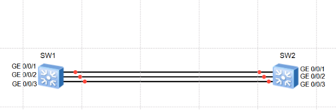
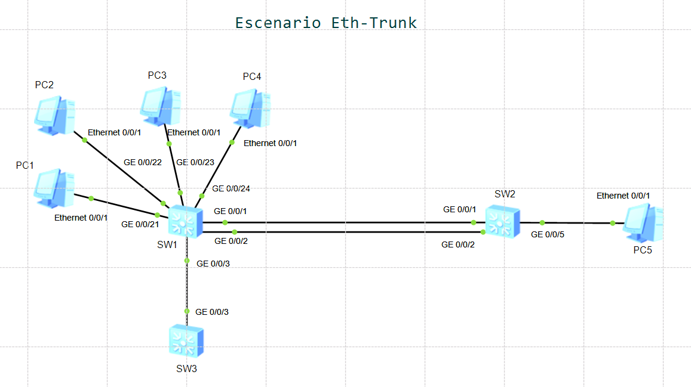

# Laboratorio 02: Link Aggregation (Eth-Trunk)

[](https://e.huawei.com)
[]()
[]()
[]()

Práctica de laboratorio enfocada en la agregación de enlaces Ethernet (**Link Aggregation / Eth-Trunk**) sobre switches **Huawei S5700** en eNSP. Se analiza a profundidad la diferencia operativa entre el **modo Manual (Load-Balance)** y el **modo dinámico LACP Estático (IEEE 802.3ad)**, control de umbrales activos, preemption, algoritmos de balanceo de carga y un escenario de análisis de fallas por error de cableado.

---

## Topología de Red

La topología interconecta dos switches mediante tres interfaces GigabitEthernet agrupadas en una interfaz lógica agregada (`Eth-Trunk 1`):




## Configuración Paso a Paso

### I. Configuración Inicial de Hostnames y Notificaciones

En ambos switches, asignamos sus nombres de dispositivo y silenciamos las alertas emergentes de consola:

```text
<Huawei> system-view

[Huawei] sysname S1

[S1] undo info-center enable
```
*(Repetir en S2 cambiando el nombre correspondiente).*

---

### II. Configuración de Link Aggregation en Modo Manual

En el **modo manual load-balance**, todos los puertos miembros agregados permanecen activos simultáneamente reenviando tráfico. No existe intercambio de paquetes de control ni validación lógica entre los extremos.

#### 2.1 Creación de la interfaz lógica Eth-Trunk:
```text
[S1] interface Eth-Trunk 1
[S1-Eth-Trunk1] mode manual load-balance
[S1-Eth-Trunk1] quit

[S2] interface Eth-Trunk 1
[S2-Eth-Trunk1] mode manual load-balance
[S2-Eth-Trunk1] quit
```
> *Nota:* En Huawei VRP, `manual load-balance` es el modo por defecto de un Eth-Trunk.

#### 2.2 Agregación de puertos miembros:
Demostramos los dos métodos disponibles en Huawei VRP para añadir interfaces físicas al grupo lógico:

* **Método A (Desde la interfaz física, aplicado en S1):**
```text
[S1] interface GigabitEthernet 0/0/1
[S1-GigabitEthernet0/0/1] eth-trunk 1
[S1-GigabitEthernet0/0/1] quit

[S1] interface GigabitEthernet 0/0/2
[S1-GigabitEthernet0/0/2] eth-trunk 1
[S1-GigabitEthernet0/0/2] quit

[S1] interface GigabitEthernet 0/0/3
[S1-GigabitEthernet0/0/3] eth-trunk 1
[S1-GigabitEthernet0/0/3] quit
```

* **Método B (Desde la interfaz lógica Eth-Trunk, aplicado en S2):**
```text
[S2] interface Eth-Trunk 1
[S2-Eth-Trunk1] trunkport GigabitEthernet 0/0/1 to 0/0/3
[S2-Eth-Trunk1] quit
```

> **Reglas de diseño en Eth-Trunk:**
> 1. Un Eth-Trunk admite un máximo de **8 puertos miembros activos**.
> 2. Una interfaz física solo puede pertenecer a un único Eth-Trunk a la vez.
> 3. Todas las interfaces del trunk deben coincidir en velocidad, modo dúplex y tipo de enlace.

#### 2.3 Verificación del estado en modo manual:
```text
[S1] display eth-trunk 1

[S2] display eth-trunk 1
```
> Se debe observar que el estado del trunk es `Up`, los 3 puertos aparecen en estado `Selected` y el ancho de banda total es la suma de los enlaces (3 Gbps).

---

### III. Configuración de Link Aggregation en Modo LACP Estático

A diferencia del modo manual, **LACP (Link Aggregation Control Protocol - IEEE 802.3ad)** intercambia tramas de control (*LACPDUs*) periódicas para validar la coherencia de cableado y permitir esquemas de enlaces activos con redundancia en espera (*standby*).

#### 3.1 Vaciar el Eth-Trunk:
En VRP, no es posible cambiar el modo operativo de un Eth-Trunk si contiene puertos miembros asociados. Primero debemos removerlos:

```text
[S1] interface Eth-Trunk 1
[S1-Eth-Trunk1] undo trunkport GigabitEthernet 0/0/1 to 0/0/3

[S2] interface Eth-Trunk 1
[S2-Eth-Trunk1] undo trunkport GigabitEthernet 0/0/1 to 0/0/3
```

#### 3.2 Cambiar modo a LACP y reasociar puertos:
```text
[S1] interface Eth-Trunk 1
[S1-Eth-Trunk1] mode lacp-static
[S1-Eth-Trunk1] trunkport GigabitEthernet 0/0/1 to 0/0/3
[S1-Eth-Trunk1] quit

[S2] interface Eth-Trunk 1
[S2-Eth-Trunk1] mode lacp-static
[S2-Eth-Trunk1] trunkport GigabitEthernet 0/0/1 to 0/0/3
[S2-Eth-Trunk1] quit
```

#### 3.3 Diagnóstico de LACP e identificación de MACs:
```text
[S1] display eth-trunk 1
[S2] display eth-trunk 1

[S1] display bridge mac-address
[S2] display bridge mac-address
```

---

### IV. Selección de Switch Actor y Puerto Backup

En una arquitectura LACP, el **Switch Actor** es el dispositivo que determina cuáles puertos se activan y cuáles quedan en reserva. Por defecto, ambos switches tienen prioridad de sistema `32768`, por lo que el Actor se elige por la menor dirección MAC.

Para asegurar un diseño determinista:

1. **Configuramos S1 como Actor** reduciendo su prioridad de sistema LACP a `100` (menor valor = mayor preferencia):
```text
[S1] lacp priority 100
```

2. **Designamos GE 0/0/3 como enlace de Backup** aumentando numéricamente su prioridad de puerto en S1 a `40000` (el valor por defecto es `32768`):
```text
[S1] interface GigabitEthernet 0/0/3
[S1-GigabitEthernet0/0/3] lacp priority 40000
[S1-GigabitEthernet0/0/3] quit
```
> Como S1 es el Actor, elegirá primero los puertos con menor prioridad (`GE 0/0/1` y `GE 0/0/2` con `32768`). `GE 0/0/3` con prioridad `40000` quedará en estado de espera.

---

### V. Configuración de Umbrales Activos y Preemption

Configuramos las políticas de control en el Actor (S1):

```text
[S1] interface Eth-Trunk 1
[S1-Eth-Trunk1] max active-linknumber 2
[S1-Eth-Trunk1] least active-linknumber 2
[S1-Eth-Trunk1] lacp preempt enable
[S1-Eth-Trunk1] quit
```

* **`max active-linknumber 2`:** Limita a 2 el número de enlaces reenviando tráfico simultáneamente. El 3er enlace queda en reserva (*Unselected*).

* **`least active-linknumber 2`:** Garantiza un ancho de banda mínimo. Si el número de enlaces activos cae por debajo de 2, todo el Eth-Trunk se suspende (`Down`) para forzar el desvío de tráfico a rutas de respaldo alternas.

* **`lacp preempt enable`:** Permite que si un enlace de alta prioridad que falló vuelve a estar operativo, recupere automáticamente su rol activo tras el tiempo de retardo (*preempt delay*).

#### Verificación del estado:
```text
[S1] display eth-trunk 1
```
> Se valida que `GE 0/0/1` y `GE 0/0/2` están en estado **Selected**, mientras que `GE 0/0/3` está en estado **Unselected** (Standby).

---

### VI. Simulación de Fallas y Comprobación de Umbrales

#### 6.1 Falla de un enlace activo (Failover a Backup):
Apagamos la interfaz activa `GE 0/0/2`:
```text
[S1] interface GigabitEthernet 0/0/2
[S1-GigabitEthernet0/0/2] shutdown
[S1-GigabitEthernet0/0/2] quit
```

Comprobamos con `display eth-trunk 1`:
> Inmediatamente `GE 0/0/3` cambia de estado de **Unselected $\rightarrow$ Selected**, manteniendo el número requerido de 2 enlaces activos sin interrumpir la conectividad.

#### 6.2 Falla total por violación del umbral mínimo:
Apagamos ahora el enlace de respaldo que acaba de entrar (`GE 0/0/3`):
```text
[S1] interface GigabitEthernet 0/0/3
[S1-GigabitEthernet0/0/3] shutdown
[S1-GigabitEthernet0/0/3] quit
```

Comprobamos con `display eth-trunk 1`:
> Al quedar únicamente 1 enlace físico activo (`GE 0/0/1`), se incumple la regla `least active-linknumber 2`. **El Eth-Trunk cambia su estado operativo general a DOWN**, protegiendo la red contra saturación de ancho de banda.

---

### VII. Recuperación y Algoritmos de Balanceo de Carga

Reactivamos los puertos apagados en S1:
```text
[S1] interface GigabitEthernet 0/0/2
[S1-GigabitEthernet0/0/2] undo shutdown
[S1-GigabitEthernet0/0/2] quit

[S1] interface GigabitEthernet 0/0/3
[S1-GigabitEthernet0/0/3] undo shutdown
[S1-GigabitEthernet0/0/3] quit
```

> Gracias a `lacp preempt enable`, `GE 0/0/2` recupera su rol activo (*Selected*) y `GE 0/0/3` regresa automáticamente a reserva (*Unselected*).

#### Configuración del algoritmo de balanceo:
Por defecto, Huawei utiliza un hash basado en direcciones MAC o IPs. Ajustamos el balanceo basado en la dirección IP destino:

```text
[S1] interface Eth-Trunk 1
[S1-Eth-Trunk1] load-balance dst-ip
[S1-Eth-Trunk1] quit
```
> En este caso se usa la IP destino, es decir, todos los paquetes al mismo destino siempre van por el mismo enlace.

---

### VIII. Escenario Extra: Simulación de Error de Conexión Humana (Manual vs LACP)

Supongamos que se tiene el siguiente escenario: Un técnico conecta accidentalmente uno de los enlaces de un Eth-Trunk manual al switch incorrecto (S3 en lugar de S2). Al no utilizar LACP para validar lógicamente, el switch origen asume que el enlace es válido basándose solo en el estado físico del puerto. ¿Como afectara esto?

Partiendo de la topologia actual, se deberan modificar algunas cosas para poder llevar a cabo dicho escenario, por lo cual, los cambios son los siguientes:

* Eliminar el cable correspondiente al GE 0/0/3 que conecta S1 con S2.

* Agregar un nuevo Switch llamado S3.

* Agregar el cable del GE 0/0/3 nuevamente, pero ahora del S1 al S3.

* Conectar 4 PCs a S1 y 1 PC concetada a 2, todas en la misma subred.




#### Direccionamiento IP del Escenario:

| Dispositivo | Conexión en Switch | Dirección IP | Máscara de Subred |
| :--- | :--- | :--- | :--- |
| **PC 1** | S1 (GE 0/0/21) | `192.168.10.11` | `255.255.255.0` |
| **PC 2** | S1 (GE 0/0/22) | `192.168.10.12` | `255.255.255.0` |
| **PC 3** | S1 (GE 0/0/23) | `192.168.10.13` | `255.255.255.0` |
| **PC 4** | S1 (GE 0/0/24) | `192.168.10.14` | `255.255.255.0` |
| **PC 5** | S2 (GE 0/0/5) | `192.168.10.20` | `255.255.255.0` |

#### Configuración del fallo en Modo Manual:
Desarmamos LACP en ambos switches y regresamos al modo manual con balanceo por MAC de origen:

* **En S1:**
```text
[S1] interface Eth-Trunk 1
[S1-Eth-Trunk1] undo trunkport GigabitEthernet 0/0/1 to 0/0/3
[S1-Eth-Trunk1] undo mode
[S1-Eth-Trunk1] load-balance src-mac
[S1-Eth-Trunk1] trunkport GigabitEthernet 0/0/1 to 0/0/3
[S1-Eth-Trunk1] quit
```

* **En S2 (sólo tiene conectados los puertos 1 y 2):**
```text
[S2] interface Eth-Trunk 1
[S2-Eth-Trunk1] undo trunkport GigabitEthernet 0/0/1 to 0/0/3
[S2-Eth-Trunk1] undo mode
[S2-Eth-Trunk1] trunkport GigabitEthernet 0/0/1 to 0/0/2
[S2-Eth-Trunk1] quit
```

#### Prueba de Tráfico desde las PCs:
Desde cada una de las 4 PCs conectadas a S1 ejecutamos un ping hacia `192.168.10.20` (PC 5 en S2):
```text
ping 192.168.10.20
```

#### Análisis y Conclusión del Fallo:

* **En Modo Manual:** A S1 no le importa qué dispositivo está conectado al otro extremo; como la interfaz `GE 0/0/3` tiene enlace físico (*Link Up* hacia S3), el algoritmo `load-balance src-mac` distribuye parte de los flujos de las PCs a través de esa interfaz. Esos paquetes terminan descartados en S3, provocando pérdida intermitente o total de paquetes.

* **Si se utilizara LACP:** LACP detecta mediante LACPDUs que el vecino en `GE 0/0/3` no pertenece al mismo sistema ni comparte el mismo System ID que S2. Por lo tanto, **LACP colocaría inmediatamente el puerto en estado Unselected**, impidiendo que se reenvíe tráfico por él y evitando la degradación del servicio.

---

## Recursos del Laboratorio

* **Configuraciones de equipos:**
  * [Configuración Switch S1](./configs/S1.txt)
  * [Configuración Switch S2](./configs/S2.txt)
  * [Configuración Escenario Extra](./configs/Escenario-Extra.txt)
* **Proyecto eNSP:**
  * [Topología Principal(.topo)](./ensp-project/Eth-Trunk.topo)
  * [Topología Escenario(.topo)](./ensp-project/Escenario-Eth-Trunk.topo)

---

[Volver a la Página Principal](../README.md)
