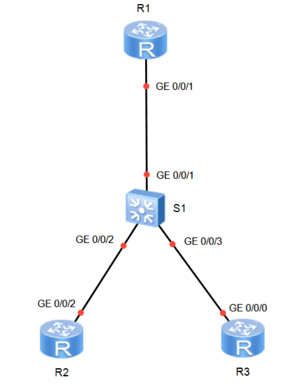

# Laboratorio 03: Inter-VLAN Routing

[](https://e.huawei.com)
[]()
[]()
[]()

Práctica de laboratorio enfocada en la comunicación entre diferentes redes de área local virtuales (**Inter-VLAN Routing**) sobre routers **Huawei AR2220** y switches **Huawei S5700** en eNSP. Se analizan e implementan de forma comparativa los dos enfoques estándar de la industria: **Router-on-a-Stick** con subinterfaces 802.1Q y **Switching de Capa 3** mediante interfaces virtuales (**VLANIF**).

---

## Topología de Red

La topología está conformada por un router principal (R1), un switch central (S1) y dos routers (R2 y R3) que operan como hosts terminales en segmentos VLAN independientes:




> *Nota de diseño:* Se utilizan routers AR2220 en los extremos (R2 y R3) en lugar de PCs genéricas para permitir pruebas de diagnóstico completas (`ping`, `tracert`, visualización de tablas de enrutamiento y resolución ARP).


## Configuración Paso a Paso

### I. Configuración de Hosts y Creación de VLANs

#### 1.1 Configuración de R2 (Host en VLAN 2):
Asignamos nombre, silenciamos alertas, configuramos la dirección IP y establecemos una ruta estática por defecto que apunte al gateway:
```text
<Huawei> system-view
[Huawei] sysname R2
[R2] undo info-center enable
[R2] interface GigabitEthernet 0/0/2
[R2-GigabitEthernet0/0/2] ip address 192.168.2.1 24
[R2-GigabitEthernet0/0/2] quit
[R2] ip route-static 0.0.0.0 0 192.168.2.254
```

#### 1.2 Configuración de R3 (Host en VLAN 3):
Configuramos la interfaz física y su respectiva ruta estática por defecto hacia el gateway de la VLAN 3:
```text
<Huawei> system-view
[Huawei] sysname R3
[R3] undo info-center enable
[R3] interface GigabitEthernet 0/0/0
[R3-GigabitEthernet0/0/0] ip address 192.168.3.1 24
[R3-GigabitEthernet0/0/0] quit
[R3] ip route-static 0.0.0.0 0 192.168.3.254
```

#### 1.3 Configuración de Puertos de Acceso en S1:
Creamos las VLANs 2 y 3 en lote (`vlan batch`) y configuramos las interfaces hacia R2 y R3 en modo acceso:
```text
<Huawei> system-view
[Huawei] sysname S1
[S1] undo info-center enable
[S1] vlan batch 2 3

[S1] interface GigabitEthernet 0/0/2
[S1-GigabitEthernet0/0/2] port link-type access
[S1-GigabitEthernet0/0/2] port default vlan 2
[S1-GigabitEthernet0/0/2] quit

[S1] interface GigabitEthernet 0/0/3
[S1-GigabitEthernet0/0/3] port link-type access
[S1-GigabitEthernet0/0/3] port default vlan 3
[S1-GigabitEthernet0/0/3] quit
```

---

### II. Método 1: Router-on-a-Stick (Subinterfaces 802.1Q)

En este modelo, un router físico externo realiza el enrutamiento inter-VLAN a través de un único enlace troncal físico compartido.

#### 2.1 Configurar enlace troncal en S1 hacia R1
```text
[S1] interface GigabitEthernet 0/0/1
[S1-GigabitEthernet0/0/1] port link-type trunk
[S1-GigabitEthernet0/0/1] port trunk allow-pass vlan 2 3
[S1-GigabitEthernet0/0/1] quit
```

#### 2.2 Crear subinterfaz para VLAN 2 en R1
```text
<Huawei> system-view
[Huawei] sysname R1
[R1] undo info-center enable

[R1] interface GigabitEthernet 0/0/1.2
[R1-GigabitEthernet0/0/1.2] dot1q termination vid 2
[R1-GigabitEthernet0/0/1.2] arp broadcast enable
[R1-GigabitEthernet0/0/1.2] ip address 192.168.2.254 24
[R1-GigabitEthernet0/0/1.2] quit
```

#### 2.3 Crear subinterfaz para VLAN 3 en R1
```text
[R1] interface GigabitEthernet 0/0/1.3
[R1-GigabitEthernet0/0/1.3] dot1q termination vid 3
[R1-GigabitEthernet0/0/1.3] arp broadcast enable
[R1-GigabitEthernet0/0/1.3] ip address 192.168.3.254 24
[R1-GigabitEthernet0/0/1.3] quit
```

> **Nota:** Por defecto, las subinterfaces lógicas de Huawei VRP tienen deshabilitada la respuesta y reenvío de paquetes ARP broadcast. Si no se introduce explícitamente `arp broadcast enable`, el router no responderá a las peticiones ARP de los hosts y la comunicación fallará a nivel de Capa 2.

#### 2.4 Pruebas de conectividad y rastreo de ruta
Desde la consola de R2 probamos el alcance hacia R3:
```text
<R2> ping 192.168.3.1
<R2> tracert 192.168.3.1
```

---

### III. Limpieza del Método 1

Para evaluar el segundo método sin interferencias, removemos la configuración troncal y las subinterfaces:

* **En S1:**
```text
[S1] interface GigabitEthernet 0/0/1
[S1-GigabitEthernet0/0/1] undo port trunk allow-pass vlan 2 3
[S1-GigabitEthernet0/0/1] undo port link-type
[S1-GigabitEthernet0/0/1] quit
```

* **En R1:**
```text
[R1] undo interface GigabitEthernet 0/0/1.2
[R1] undo interface GigabitEthernet 0/0/1.3
```
---

### IV. Método 2: Switch de Capa 3 (Interfaces VLANIF)

En este modelo, el switch multicapa realiza el enrutamiento directamente en hardware mediante interfaces virtuales de Capa 3 (**VLANIF**), eliminando la necesidad de un router externo y optimizando el ancho de banda.

#### 4.1 Configurar Gateway de VLAN 2 en S1
```text
[S1] interface Vlanif 2
[S1-Vlanif2] ip address 192.168.2.254 24
[S1-Vlanif2] quit
```

#### 4.2 Configurar Gateway de VLAN 3 en S1
```text
[S1] interface Vlanif 3
[S1-Vlanif3] ip address 192.168.3.254 24
[S1-Vlanif3] quit
```

#### 4.3 Verificación de Interfaces VLANIF y Conectividad
Verificamos que las interfaces lógicas estén operativas (`Up`):
```text
[S1] display interface Vlanif 2
[S1] display interface Vlanif 3
```

Realizamos la prueba de conectividad y rastreo desde R2:
```text
<R2> ping 192.168.3.1
<R2> tracert 192.168.3.1
```


## Recursos del Laboratorio

* **Configuraciones de equipos:**
  * [Configuración Router R1](./configs/R1.txt)
  * [Configuración Host R2](./configs/R2.txt)
  * [Configuración Host R3](./configs/R3.txt)
  * [Configuración Switch S1](./configs/S1.txt)
* **Proyecto eNSP:**
  * [Topología](./ensp-project/InterVLAN.topo)

---

[Volver a la Página Principal](../README.md)
