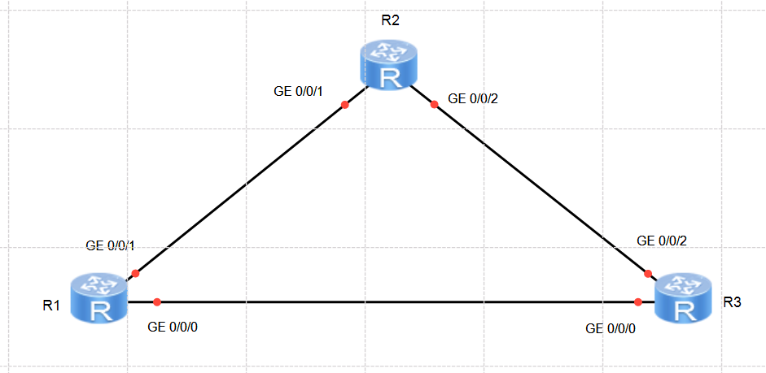

# Laboratorio 04: IP Routing Basics

[](https://e.huawei.com)
[]()
[]()
[]()

Práctica de laboratorio enfocada en los principios fundamentales de enrutamiento IP en la plataforma **Huawei VRP** utilizando routers **Huawei AR2220** en eNSP. Se analiza la tabla de enrutamiento IP, el comportamiento de las rutas directas, la configuración de **rutas estáticas** punto a punto, la implementación de **rutas flotantes** mediante la manipulación de la preferencia de protocolo, la conmutación automática ante fallas de enlace y el despliegue de **rutas por defecto**.

---

## Topología de Red



---

## Plan de Direccionamiento IP

### Interfaces Físicas

| Router | Interfaz | Dirección IP / Máscara |
| :--- | :--- | :--- |
| **R1** | `GigabitEthernet0/0/0` | `10.0.13.1/24` |
| **R1** | `GigabitEthernet0/0/1` | `10.0.12.1/24` |
| **R2** | `GigabitEthernet0/0/1` | `10.0.12.2/24` |
| **R2** | `GigabitEthernet0/0/2` | `10.0.23.2/24` |
| **R3** | `GigabitEthernet0/0/0` | `10.0.13.3/24` |
| **R3** | `GigabitEthernet0/0/2` | `10.0.23.3/24` |

### Interfaces LoopBack

| Router | Interfaz | Dirección IP / Máscara |
| :--- | :--- | :--- |
| **R1** | `LoopBack0` | `10.0.1.1/32` |
| **R2** | `LoopBack0` | `10.0.1.2/32` |
| **R3** | `LoopBack0` | `10.0.1.3/32` |

---

## Configuración Paso a Paso

### Preparación Inicial

En cada router, silenciamos las notificaciones del centro de información y establecemos los nombres de host correspondientes:

```text
<Huawei> system-view
[Huawei] undo info-center enable
[Huawei] sysname R1
```
*(Repetir en R2 y R3 asignando sus respectivos nombres `R2` y `R3`).*

---

### I. Verificar el estado inicial de las interfaces

Verificamos el estado físico y de protocolo de las interfaces en cada router:

```text
[R1] display ip interface brief
[R2] display ip interface brief
[R3] display ip interface brief
```

---

### II. Consultar la tabla de enrutamiento inicial

Antes de asignar direcciones IP, examinamos la tabla de enrutamiento global:

```text
[R1] display ip routing-table
[R2] display ip routing-table
[R3] display ip routing-table
```

---

### III. Configurar direcciones IP en las interfaces físicas

Configuramos las direcciones IP según el plan de direccionamiento:

#### En R1:
```text
<R1> system-view
[R1] interface GigabitEthernet 0/0/0
[R1-GigabitEthernet0/0/0] ip address 10.0.13.1 24
[R1-GigabitEthernet0/0/0] quit

[R1] interface GigabitEthernet 0/0/1
[R1-GigabitEthernet0/0/1] ip address 10.0.12.1 24
[R1-GigabitEthernet0/0/1] quit
```

#### En R2:
```text
<R2> system-view
[R2] interface GigabitEthernet 0/0/1
[R2-GigabitEthernet0/0/1] ip address 10.0.12.2 24
[R2-GigabitEthernet0/0/1] quit

[R2] interface GigabitEthernet 0/0/2
[R2-GigabitEthernet0/0/2] ip address 10.0.23.2 24
[R2-GigabitEthernet0/0/2] quit
```

#### En R3:
```text
<R3> system-view
[R3] interface GigabitEthernet 0/0/0
[R3-GigabitEthernet0/0/0] ip address 10.0.13.3 24
[R3-GigabitEthernet0/0/0] quit

[R3] interface GigabitEthernet 0/0/2
[R3-GigabitEthernet0/0/2] ip address 10.0.23.3 24
[R3-GigabitEthernet0/0/2] quit
```

---

### IV. Verificar conectividad directa entre vecinos

Comprobamos que los enlaces físicos adyacentes respondan correctamente:

```text
[R1] ping 10.0.12.2
[R1] ping 10.0.13.3
```

---

### V. Consultar la tabla de enrutamiento después de configurar las interfaces

Consultamos nuevamente la tabla de enrutamiento:

```text
[R1] display ip routing-table
[R2] display ip routing-table
[R3] display ip routing-table
```

---

### VI. Crear interfaces LoopBack

Configuramos las interfaces de prueba LoopBack 0 en cada equipo:

#### En R1:
```text
[R1] interface LoopBack 0
[R1-LoopBack0] ip address 10.0.1.1 32
[R1-LoopBack0] quit
```

#### En R2:
```text
[R2] interface LoopBack 0
[R2-LoopBack0] ip address 10.0.1.2 32
[R2-LoopBack0] quit
```

#### En R3:
```text
[R3] interface LoopBack 0
[R3-LoopBack0] ip address 10.0.1.3 32
[R3-LoopBack0] quit
```

---

### VII. Probar conectividad entre interfaces LoopBack

Realizamos una prueba de ping originada desde la LoopBack0 de R1 hacia la LoopBack0 de R2:

```text
[R1] ping -a 10.0.1.1 10.0.1.2
```
> **Resultado:** La prueba falla. Aunque ambos routers tienen interfaces IP operativas, R1 desconoce cómo llegar al prefijo `10.0.1.2/32`.

---

### VIII. Configurar rutas estáticas

#### 8.1. Configuración en R1 hacia las LoopBacks de R2 y R3
```text
[R1] ip route-static 10.0.1.2 32 10.0.12.2
[R1] ip route-static 10.0.1.3 32 10.0.13.3
```

Verificamos la tabla de enrutamiento de R1:
```text
[R1] display ip routing-table
```

Probamos la conectividad hacia R2:
```text
[R1] ping -a 10.0.1.1 10.0.1.2
```
> **Nota:** La prueba aún falla debido a que el enrutamiento es unidireccional: R1 sabe enviar el paquete a R2, pero R2 todavía no conoce la ruta de retorno hacia `10.0.1.1/32`.

#### 8.2. Configuración en R2
```text
[R2] ip route-static 10.0.1.1 32 10.0.12.1
[R2] ip route-static 10.0.1.3 32 10.0.23.3
```

Validamos nuevamente la conectividad desde R1:
```text
[R1] ping -a 10.0.1.1 10.0.1.2
```
> **Resultado:** El ping responde satisfactoriamente al existir caminos de ida y vuelta.

#### 8.3. Configuración en R3 hacia R1 y R2
```text
[R3] ip route-static 10.0.1.1 32 10.0.13.1
[R3] ip route-static 10.0.1.2 32 10.0.23.2
```

---

### IX. Configurar rutas de respaldo (Floating Static Routes)

Configuramos una ruta alternativa a través de R3 como respaldo para la comunicación entre la LoopBack0 de R1 y la LoopBack0 de R2.

En Huawei VRP, la preferencia por defecto de una ruta estática es **60**. Al asignar un valor numérico mayor, la ruta queda en espera en la base de datos de enrutamiento y solo se instalará en la FIB activa si la ruta principal falla.

#### 9.1. Configurar rutas flotantes con preferencia 100
```text
[R1] ip route-static 10.0.1.2 32 10.0.13.3 preference 100
[R2] ip route-static 10.0.1.1 32 10.0.23.3 preference 100
```

#### 9.2. Consultar la tabla de enrutamiento de R1 y R2
```text
[R1] display ip routing-table
[R2] display ip routing-table
```
> **Observación:** La ruta con `preference 100` no aparece en la tabla de enrutamiento activa debido a que la ruta primaria (`preference 60`) tiene mayor prioridad (menor valor numérico).

#### 9.3. Simular una falla en el enlace principal
Apagamos la interfaz `GigabitEthernet0/0/1` en R1 para invalidar la ruta principal:
```text
[R1] interface GigabitEthernet 0/0/1
[R1-GigabitEthernet0/0/1] shutdown
[R1-GigabitEthernet0/0/1] quit
```

#### 9.4. Verificar la conmutación
Consultamos las tablas de ruteo en R1 y R2:
```text
[R1] display ip routing-table
[R2] display ip routing-table
```
> **Resultado:** La ruta primaria desaparece al caer el enlace y la ruta flotante vía R3 (`NextHop: 10.0.13.3`, `Pre: 100`) pasa de forma inmediata a la tabla de enrutamiento activa.

Validamos la conectividad y rastreamos el trayecto del paquete:
```text
[R1] ping -a 10.0.1.1 10.0.1.2
[R1] tracert -a 10.0.1.1 10.0.1.2
```
> En la salida de `tracert` se aprecia que el primer salto es `10.0.13.3` (R3) y el segundo salto es `10.0.23.2` (R2), confirmando el desvío por la ruta de respaldo.

---

### X. Configurar una ruta por defecto

#### 10.1. Restaurar la interfaz y eliminar las rutas estáticas específicas hacia R2
```text
[R1] interface GigabitEthernet 0/0/1
[R1-GigabitEthernet0/0/1] undo shutdown
[R1-GigabitEthernet0/0/1] quit

[R1] undo ip route-static 10.0.1.2 32 10.0.12.2
[R1] undo ip route-static 10.0.1.2 32 10.0.13.3 preference 100
```

Muestre la tabla de ruteo de R1:
```text
[R1] display ip routing-table
```

#### 10.2. Configurar la ruta por defecto
Configuramos una ruta por defecto en R1 para capturar cualquier destino desconocido a través del enlace hacia R2:
```text
[R1] ip route-static 0.0.0.0 0 10.0.12.2
```

Muestre la tabla de ruteo de R1:
```text
[R1] display ip routing-table
```

#### 10.3. Comprobar la conectividad
Probamos la conectividad entre la LoopBack0 de R1 y la LoopBack0 de R2:
```text
[R1] ping -a 10.0.1.1 10.0.1.2
```

---

## Recursos del Laboratorio

* **Configuraciones de los equipos:**
  * [Configuración Router R1](./configs/R1.txt)
  * [Configuración Router R2](./configs/R2.txt)
  * [Configuración Router R3](./configs/R3.txt)
* **Proyecto eNSP:**
  * [Topología del Laboratorio](./ensp-project/IP-Routing-Basics.topo)

---

[Volver a la Página Principal](../README.md)
