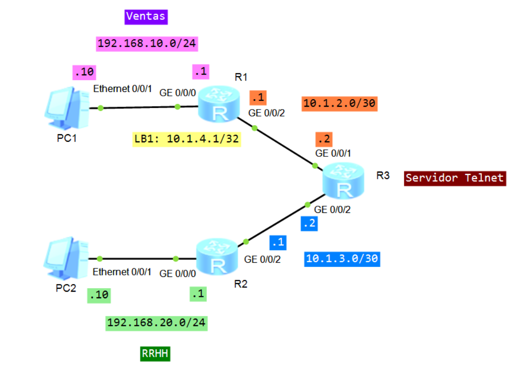
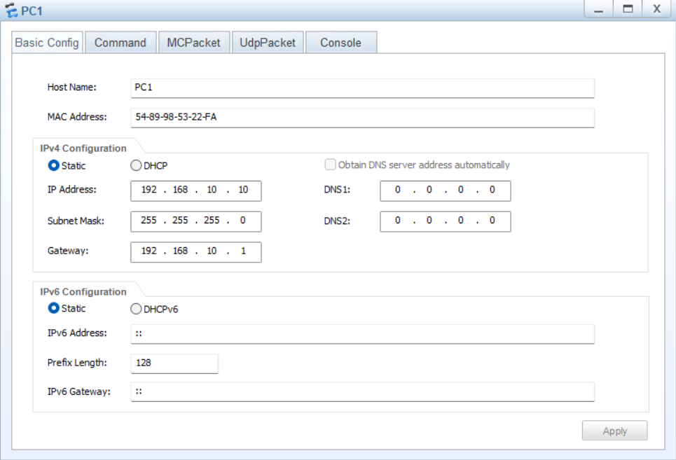
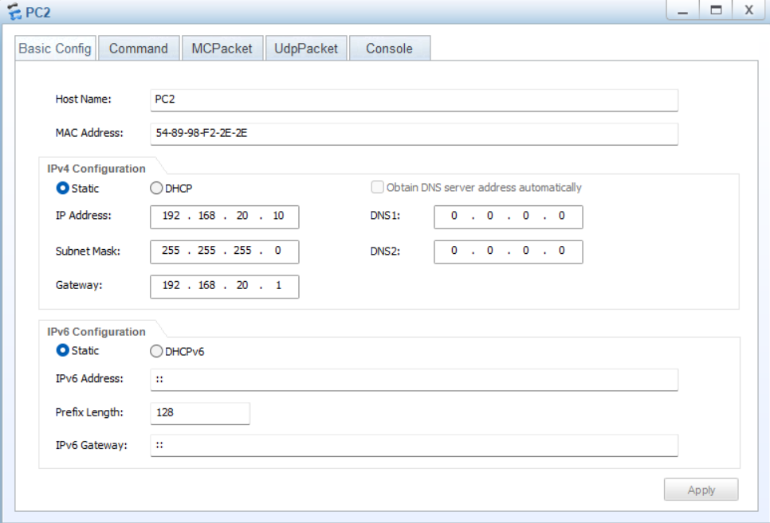

# Laboratorio 07: Access Control Lists (ACL)

[](https://e.huawei.com)
[]()
[]()
[]()

Práctica de laboratorio enfocada en el uso de **ACL básicas y avanzadas** en Huawei VRP para controlar el acceso remoto por Telnet a un router. Se comparan ACL numeradas y nombradas, se filtra por dirección IP de origen y por protocolo, dirección de destino y puerto, y se observa el comportamiento de una ACL vacía y de una ACL con reglas.

---

## Topología de Red

La topología utiliza tres routers. R1 conecta la red de Ventas y R2 conecta la red de RRHH; ambos llegan a R3 por enlaces `/30`. R3 actúa como servidor Telnet y punto de aplicación de las ACL en las líneas VTY.



## Plan de Direccionamiento IP

| Dispositivo | Interfaz | Dirección IP / Máscara |
| :--- | :--- | :--- |
| **PC1 (Ventas)** | Ethernet0/0/1 | `192.168.10.10/24` |
| **R1** | GigabitEthernet0/0/0 | `192.168.10.1/24` |
| **R1** | GigabitEthernet0/0/2 | `10.1.2.1/30` |
| **R1** | LoopBack1 | `10.1.4.1/32` |
| **R3** | GigabitEthernet0/0/1 | `10.1.2.2/30` |
| **R3** | GigabitEthernet0/0/2 | `10.1.3.2/30` |
| **R2** | GigabitEthernet0/0/2 | `10.1.3.1/30` |
| **R2** | GigabitEthernet0/0/0 | `192.168.20.1/24` |
| **PC2 (RRHH)** | Ethernet0/0/1 | `192.168.20.10/24` |

PC1 usa `192.168.10.1` como gateway y PC2 usa `192.168.20.1`.





---

## Configuración Paso a Paso

### I. Configuración base

#### 1.1 Direccionamiento en R1

```text
<R1> system-view
[R1] interface GigabitEthernet 0/0/0
[R1-GigabitEthernet0/0/0] ip address 192.168.10.1 24
[R1-GigabitEthernet0/0/0] quit
[R1] interface GigabitEthernet 0/0/2
[R1-GigabitEthernet0/0/2] ip address 10.1.2.1 30
[R1-GigabitEthernet0/0/2] quit
[R1] interface LoopBack 1
[R1-LoopBack1] ip address 10.1.4.1 32
[R1-LoopBack1] quit
```

#### 1.2 Direccionamiento en R2

```text
<R2> system-view
[R2] interface GigabitEthernet 0/0/0
[R2-GigabitEthernet0/0/0] ip address 192.168.20.1 24
[R2-GigabitEthernet0/0/0] quit
[R2] interface GigabitEthernet 0/0/2
[R2-GigabitEthernet0/0/2] ip address 10.1.3.1 30
[R2-GigabitEthernet0/0/2] quit
```

#### 1.3 Direccionamiento en R3

```text
<R3> system-view
[R3] interface GigabitEthernet 0/0/1
[R3-GigabitEthernet0/0/1] ip address 10.1.2.2 30
[R3-GigabitEthernet0/0/1] quit
[R3] interface GigabitEthernet 0/0/2
[R3-GigabitEthernet0/0/2] ip address 10.1.3.2 30
[R3-GigabitEthernet0/0/2] quit
```

Configura las direcciones de PC1 y PC2 según la tabla de direccionamiento.

#### 1.4 Habilitar OSPF en el área 0

En R1:

```text
[R1] ospf 1
[R1-ospf-1] area 0
[R1-ospf-1-area-0.0.0.0] network 192.168.10.0 0.0.0.255
[R1-ospf-1-area-0.0.0.0] network 10.1.2.1 0.0.0.0
[R1-ospf-1-area-0.0.0.0] network 10.1.4.1 0.0.0.0
[R1-ospf-1-area-0.0.0.0] quit
```

En R2:

```text
[R2] ospf 1
[R2-ospf-1] area 0
[R2-ospf-1-area-0.0.0.0] network 192.168.20.0 0.0.0.255
[R2-ospf-1-area-0.0.0.0] network 10.1.3.1 0.0.0.0
[R2-ospf-1-area-0.0.0.0] quit
```

En R3:

```text
[R3] ospf 1
[R3-ospf-1] area 0
[R3-ospf-1-area-0.0.0.0] network 10.1.2.2 0.0.0.0
[R3-ospf-1-area-0.0.0.0] network 10.1.3.2 0.0.0.0
[R3-ospf-1-area-0.0.0.0] quit
```

#### 1.5 Verificar conectividad antes de aplicar las ACL

Desde los routers:

```text
<R1> ping 10.1.3.2
<R2> ping 10.1.2.2
<R1> ping 192.168.20.1
```

Desde las PCs, comprueba la conectividad entre ambas redes:

```text
PC1> ping 192.168.20.10
PC2> ping 192.168.10.10
```

### II. Configurar R3 como servidor Telnet

```text
[R3] telnet server enable
[R3] user-interface vty 0 4
[R3-ui-vty0-4] authentication-mode password
[R3-ui-vty0-4] user privilege level 3
[R3-ui-vty0-4] quit
```

Prueba el acceso desde R1 y R2:

```text
<R1> telnet -a 10.1.2.1 10.1.2.2
<R2> telnet -a 10.1.3.1 10.1.3.2
```


### III. ACL básica

**Objetivo:** permitir el acceso Telnet desde Ventas (PC1 y R1) y bloquearlo desde RRHH (PC2 y R2).

#### 3.1 ACL básica numerada

```text
[R3] acl 2000
[R3-acl-basic-2000] rule 5 permit source 192.168.10.0 0.0.0.255
[R3-acl-basic-2000] rule 10 deny source any
[R3-acl-basic-2000] quit

[R3] user-interface vty 0 4
[R3-ui-vty0-4] acl 2000 inbound
[R3-ui-vty0-4] quit
```

Prueba desde los dos grupos:

```text
<R1> telnet -a 192.168.10.1 10.1.2.2
<R2> telnet -a 192.168.20.1 10.1.2.2
```

Verifica los contadores de la ACL:

```text
[R3] display acl 2000
```

#### 3.2 ACL básica nombrada

```text
[R3] acl name VENTAS-TELNET 2000
[R3-acl-basic-VENTAS-TELNET] rule 5 permit source 192.168.10.0 0.0.0.255
[R3-acl-basic-VENTAS-TELNET] rule 10 deny source any
[R3-acl-basic-VENTAS-TELNET] quit
```

Vuelve a aplicar la ACL a las líneas VTY y repite las pruebas:

```text
[R3] user-interface vty 0 4
[R3-ui-vty0-4] undo acl inbound
[R3-ui-vty0-4] acl 2000 inbound
[R3-ui-vty0-4] quit

<R1> telnet -a 192.168.10.1 10.1.2.2
<R2> telnet -a 192.168.20.1 10.1.2.2
[R3] display acl name VENTAS-TELNET
```

### IV. ACL avanzada

**Objetivo:** permitir Telnet únicamente desde la LoopBack1 de R1 y bloquear explícitamente el acceso desde la red de RRHH.

#### 4.1 ACL avanzada numerada

```text
[R3] acl 3000
[R3-acl-adv-3000] rule 5 permit tcp source 10.1.4.1 0.0.0.0 destination 10.1.2.2 0.0.0.0 destination-port eq 23
[R3-acl-adv-3000] rule 10 deny ip source 192.168.20.0 0.0.0.255 destination 10.1.2.2 0.0.0.0
[R3-acl-adv-3000] quit

[R3] user-interface vty 0 4
[R3-ui-vty0-4] undo acl inbound
[R3-ui-vty0-4] acl 3000 inbound
[R3-ui-vty0-4] quit
```

Prueba desde la LoopBack1 y desde la interfaz física de R1, y prueba el bloqueo desde RRHH:

```text
<R1> telnet -a 10.1.4.1 10.1.2.2
<R1> telnet -a 10.1.2.1 10.1.2.2
<R2> telnet -a 192.168.20.1 10.1.2.2
[R3] display acl 3000
```

#### 4.2 ACL avanzada nombrada

```text
[R3] acl name CONTROL-SERVER 3001
[R3-acl-adv-CONTROL-SERVER] rule 5 permit tcp source 10.1.4.1 0.0.0.0 destination 10.1.2.2 0.0.0.0 destination-port eq telnet
[R3-acl-adv-CONTROL-SERVER] rule 10 deny ip source 192.168.20.0 0.0.0.255 destination 10.1.2.2 0.0.0.0
[R3-acl-adv-CONTROL-SERVER] quit

[R3] user-interface vty 0 4
[R3-ui-vty0-4] undo acl inbound
[R3-ui-vty0-4] acl 3001 inbound
[R3-ui-vty0-4] quit
```

Repite las tres pruebas anteriores y consulta los contadores:

```text
<R1> telnet -a 10.1.4.1 10.1.2.2
<R1> telnet -a 10.1.2.1 10.1.2.2
<R2> telnet -a 192.168.20.1 10.1.2.2
[R3] display acl name CONTROL-SERVER
```

### V. Observar el comportamiento de una ACL sin reglas y con una regla

#### 5.1 ACL vacía

```text
[R3] acl 2020
[R3-acl-basic-2020] quit

[R3] user-interface vty 0 4
[R3-ui-vty0-4] undo acl inbound
[R3-ui-vty0-4] acl 2020 inbound
[R3-ui-vty0-4] quit
```

Prueba el acceso y consulta la ACL:

```text
<R1> telnet -a 192.168.10.1 10.1.2.2
[R3] display acl 2020
```

#### 5.2 ACL con una regla

```text
[R3] acl 2021
[R3-acl-basic-2021] rule 5 permit source 192.168.10.0 0.0.0.255
[R3-acl-basic-2021] quit

[R3] user-interface vty 0 4
[R3-ui-vty0-4] undo acl inbound
[R3-ui-vty0-4] acl 2021 inbound
[R3-ui-vty0-4] quit
```

Prueba una conexión permitida desde Ventas y otra desde RRHH:

```text
<R1> telnet -a 192.168.10.1 10.1.2.2
<R2> telnet -a 192.168.20.1 10.1.2.2
[R3] display acl 2021
```

Podemos concluir que mientras la ACL este vacía, el comportamiento será un Permit Implícito. Si la ACL tiene al menos 1 regla y el trafico no coincide con ninguna regla, entonces el comportamiento será un Deny Implícito.

---

## Recursos del Laboratorio

* **Configuraciones de los equipos:**
  * [Configuración Router R1](./configs/R1.txt)
  * [Configuración Router R2](./configs/R2.txt)
  * [Configuración Router R3](./configs/R3.txt)
* **Topología:** [Diagrama de red](./images/01-topology.png)
* **Proyecto eNSP:** [Archivo de topología (.topo)](./ensp-project/ACL.topo)

---

[Volver a la Página Principal](../README.md)
