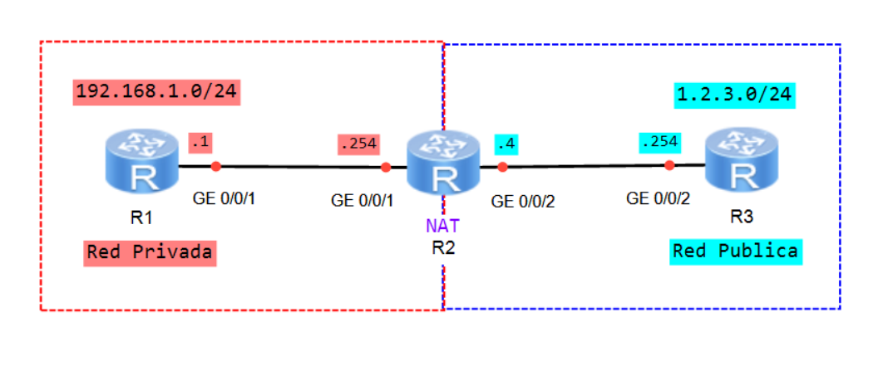

# Laboratorio 09: Network Address Translation (NAT)

[](https://e.huawei.com)
[]()
[]()
[]()

Práctica de laboratorio sobre traducción de direcciones en Huawei VRP. Se configura **NAT estático**, **NAT dinámico sin PAT**, **NAPT**, **Easy IP** y **NAT Server**, y se comparan las traducciones de tráfico saliente y entrante mediante pruebas de conectividad, Telnet y consulta de sesiones NAT.

---

## Topología de Red

R1 representa la red privada `192.168.1.0/24`. R2 realiza las traducciones entre esa red y la red pública de laboratorio `1.2.3.0/24`, donde R3 actúa como destino de las pruebas y cliente externo.



## Plan de Direccionamiento IP

| Dispositivo | Interfaz | Dirección IP / Máscara | Segmento |
| :--- | :--- | :--- | :--- |
| **R1** | GigabitEthernet0/0/1 | `192.168.1.1/24` | Red privada |
| **R2** | GigabitEthernet0/0/1 | `192.168.1.254/24` | Red privada |
| **R2** | GigabitEthernet0/0/2 | `1.2.3.4/24` | Red pública de laboratorio |
| **R3** | GigabitEthernet0/0/2 | `1.2.3.254/24` | Red pública de laboratorio |

---

## Configuración Paso a Paso

### I. Configuración base

Antes de probar NAT, configura el direccionamiento, las rutas por defecto y el acceso Telnet en R1 y R3.

#### 1.1 Configurar R1

```text
<R1> system-view
[R1] interface GigabitEthernet 0/0/1
[R1-GigabitEthernet0/0/1] ip address 192.168.1.1 24
[R1-GigabitEthernet0/0/1] quit
[R1] ip route-static 0.0.0.0 0 192.168.1.254

[R1] user-interface vty 0 4
[R1-ui-vty0-4] authentication-mode aaa
[R1-ui-vty0-4] quit
[R1] aaa
[R1-aaa] local-user profe password cipher huawei
[R1-aaa] local-user profe service-type telnet
[R1-aaa] local-user profe privilege level 15
[R1-aaa] quit
[R1] telnet server enable
```

#### 1.2 Configurar R2

```text
<R2> system-view
[R2] interface GigabitEthernet 0/0/1
[R2-GigabitEthernet0/0/1] ip address 192.168.1.254 24
[R2-GigabitEthernet0/0/1] quit
[R2] interface GigabitEthernet 0/0/2
[R2-GigabitEthernet0/0/2] ip address 1.2.3.4 24
[R2-GigabitEthernet0/0/2] quit
[R2] ip route-static 0.0.0.0 0 1.2.3.254
```

#### 1.3 Configurar R3

```text
<R3> system-view
[R3] interface GigabitEthernet 0/0/2
[R3-GigabitEthernet0/0/2] ip address 1.2.3.254 24
[R3-GigabitEthernet0/0/2] quit

[R3] user-interface vty 0 4
[R3-ui-vty0-4] authentication-mode aaa
[R3-ui-vty0-4] quit
[R3] aaa
[R3-aaa] local-user profe password cipher huawei
[R3-aaa] local-user profe service-type telnet
[R3-aaa] local-user profe privilege level 15
[R3-aaa] quit
[R3] telnet server enable
```


#### 1.4 Verificar conectividad antes de configurar NAT

Desde R1, intenta llegar a R3:

```text
[R1] ping 1.2.3.254
```

La prueba debe fallar antes de configurar NAT, porque R3 no tiene una ruta de retorno a la dirección privada de R1.

### II. NAT estático

El NAT estático establece un mapeo fijo y bidireccional entre una dirección privada y una dirección global. En este escenario se asigna `1.2.3.10` a R1 (`192.168.1.1`).

En R2, configura el mapeo en la interfaz conectada a la red pública:

```text
[R2] interface GigabitEthernet 0/0/2
[R2-GigabitEthernet0/0/2] nat static global 1.2.3.10 inside 192.168.1.1
[R2-GigabitEthernet0/0/2] quit
```

Comprueba el tráfico saliente desde R1 y el acceso entrante desde R3:

```text
[R1] ping 1.2.3.254
<R3> telnet 1.2.3.10
[R2] display nat static
```

Elimina la configuración antes del siguiente ejercicio:

```text
[R2] interface GigabitEthernet 0/0/2
[R2-GigabitEthernet0/0/2] undo nat static global 1.2.3.10 inside 192.168.1.1
[R2-GigabitEthernet0/0/2] quit
```

### III. NAT dinámico sin PAT (No-PAT)

El NAT dinámico asigna temporalmente una dirección global de un pool a cada host interno. Con `no-pat`, la traducción es uno a uno y no modifica los puertos.

En R2, crea el pool y una ACL que identifica las direcciones de origen a traducir:

```text
[R2] nat address-group 1 1.2.3.10 1.2.3.20
[R2] acl 2000
[R2-acl-basic-2000] rule 5 permit source any
[R2-acl-basic-2000] quit
```

Aplica NAT dinámico en la interfaz pública:

```text
[R2] interface GigabitEthernet 0/0/2
[R2-GigabitEthernet0/0/2] nat outbound 2000 address-group 1 no-pat
[R2-GigabitEthernet0/0/2] quit
```

Genera tráfico y consulta las sesiones:

```text
[R1] ping 1.2.3.254
[R2] display nat session all
```

Elimina la regla de la interfaz antes de continuar:

```text
[R2] interface GigabitEthernet 0/0/2
[R2-GigabitEthernet0/0/2] undo nat outbound 2000 address-group 1 no-pat
[R2-GigabitEthernet0/0/2] quit
```

### IV. NAPT

NAPT traduce la dirección IP y el puerto de origen, permitiendo que varias conexiones internas compartan direcciones globales. En este paso se reutilizan el pool y la ACL del paso anterior; la diferencia es omitir `no-pat`.

```text
[R2] interface GigabitEthernet 0/0/2
[R2-GigabitEthernet0/0/2] nat outbound 2000 address-group 1
[R2-GigabitEthernet0/0/2] quit
```

Genera una sesión TCP con Telnet y revisa la traducción de dirección y puerto:

```text
<R1> telnet 1.2.3.254
[R2] display nat session all
```

Elimina la regla antes del siguiente paso:

```text
[R2] interface GigabitEthernet 0/0/2
[R2-GigabitEthernet0/0/2] undo nat outbound 2000 address-group 1
[R2-GigabitEthernet0/0/2] quit
```

### V. Easy IP

Easy IP aplica NAPT usando como dirección global la IP de la interfaz de salida, sin crear un pool. Reutiliza la ACL 2000:

```text
[R2] interface GigabitEthernet 0/0/2
[R2-GigabitEthernet0/0/2] nat outbound 2000
[R2-GigabitEthernet0/0/2] quit
```

Verifica que las sesiones utilicen la dirección de la interfaz (`1.2.3.4`):

```text
[R1] ping 1.2.3.254
<R1> telnet 1.2.3.254
[R2] display nat session all
```

Elimina la regla antes de configurar NAT Server:

```text
[R2] interface GigabitEthernet 0/0/2
[R2-GigabitEthernet0/0/2] undo nat outbound 2000
[R2-GigabitEthernet0/0/2] quit
```

### VI. NAT Server

NAT Server permite que un host externo inicie una conexión hacia un servicio en la red privada. En este ejemplo, R2 publica el servicio Telnet de R1 mediante el puerto TCP `2323` de su interfaz pública.

En R2, configura el mapeo:

```text
[R2] interface GigabitEthernet 0/0/2
[R2-GigabitEthernet0/0/2] nat server protocol tcp global current-interface 2323 inside 192.168.1.1 telnet
[R2-GigabitEthernet0/0/2] quit
```

Desde R3, inicia la conexión hacia la IP pública de R2 y el puerto publicado:

```text
<R3> telnet 1.2.3.4 2323
```

Consulta la sesión para observar la traducción del destino:

```text
[R2] display nat session all
```

---

## Recursos del Laboratorio

* **Configuraciones de los equipos:**
  * [Configuración Router R1](./configs/R1.txt)
  * [Configuración Router R2](./configs/R2.txt)
  * [Configuración Router R3](./configs/R3.txt)
* **Topología:** [Diagrama de red](./images/01-topology.png)

---

[Volver a la Página Principal](../README.md)
